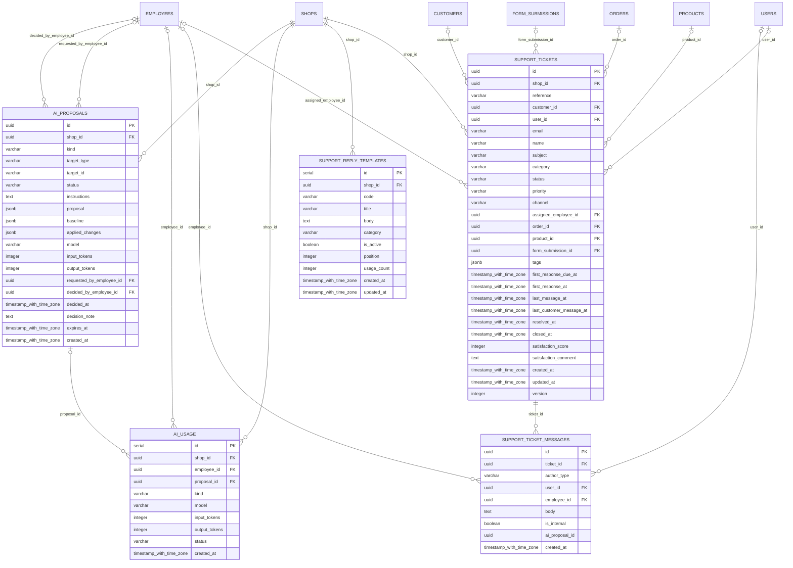

# Schéma de la base de données

> Fichier généré par `npm run docs:db` depuis `lib/db/schema.ts` (source unique). Ne pas modifier à la main : `tests/db-diagram-sync.test.ts` échoue s'il n'est plus à jour.

**136 tables, 221 clés étrangères.** Un diagramme par domaine ; une table d'un autre domaine reliée à celui-ci y figure sans ses colonnes. Notation : `PK` clé primaire, `FK` clé étrangère ; `||--o{` « un à plusieurs », `|o--o{` lien facultatif.

## Sommaire

- [Équipe, sécurité et boutiques](#equipe-securite-et-boutiques) (15 tables)
- [Catalogue](#catalogue) (30 tables)
- [Prix et stock](#prix-et-stock) (9 tables)
- [Clients, paniers et commandes](#clients-paniers-et-commandes) (26 tables)
- [Paiement et livraison](#paiement-et-livraison) (19 tables)
- [Communication, CMS et localisation](#communication-cms-et-localisation) (18 tables)
- [Service client et assistant IA](#service-client-et-assistant-ia) (5 tables)
- [Système](#systeme) (14 tables)

## Équipe, sécurité et boutiques

Employés, rôles et permissions, sessions, journal d'audit, clés d'API, boutiques et leur attribution.

```mermaid
erDiagram
  ACTIVITY_LOGS {
    uuid id PK
    uuid employee_id FK
    varchar action
    varchar entity_type
    varchar entity_id
    jsonb before_state
    jsonb after_state
    varchar ip_address
    timestamp_with_time_zone created_at
  }
  ADMIN_AUDIT_LOG {
    serial id PK
    uuid actor_user_id FK
    varchar action
    varchar entity_type
    varchar entity_id
    jsonb details
    varchar ip_address
    timestamp_with_time_zone created_at
    jsonb before_state
    jsonb after_state
    jsonb changed_fields
  }
  API_KEYS {
    uuid id PK
    varchar label
    varchar key_prefix
    varchar key_hash
    jsonb permissions
    jsonb allowed_ips
    boolean is_active
    timestamp_with_time_zone last_used_at
    uuid created_by_employee_id FK
    timestamp_with_time_zone created_at
    jsonb scopes
    timestamp_with_time_zone expires_at
    timestamp_with_time_zone revoked_at
    uuid shop_id FK
  }
  EMPLOYEE_AUDIT_LOGS {
    uuid id PK
    uuid actor_employee_id FK
    varchar action
    varchar entity_type
    varchar entity_id
    jsonb details
    varchar ip_address
    varchar user_agent
    timestamp_with_time_zone created_at
    varchar actor_type
    uuid api_key_id FK
    uuid shop_id FK
    jsonb before_state
    jsonb after_state
    jsonb changed_fields
    varchar request_id
  }
  EMPLOYEE_LOGIN_EVENTS {
    uuid id PK
    uuid employee_id FK
    varchar email_attempted
    boolean succeeded
    varchar ip_address
    varchar user_agent
    varchar failure_reason
    timestamp_with_time_zone created_at
  }
  EMPLOYEE_SECURITY_EVENTS {
    uuid id PK
    uuid employee_id FK
    varchar event_type
    varchar ip_address
    varchar user_agent
    timestamp_with_time_zone created_at
  }
  EMPLOYEE_SESSIONS {
    uuid id PK
    uuid employee_id FK
    varchar token_hash
    timestamp_with_time_zone expires_at
    timestamp_with_time_zone last_seen_at
    timestamp_with_time_zone revoked_at
    varchar ip_address
    varchar user_agent
    timestamp_with_time_zone created_at
    uuid family_id
    uuid replaced_by_session_id
    varchar revoked_reason
  }
  EMPLOYEE_SHOPS {
    serial id PK
    uuid employee_id FK
    uuid shop_id FK
    timestamp_with_time_zone created_at
  }
  EMPLOYEES {
    uuid id PK
    uuid role_id FK
    varchar email
    varchar first_name
    varchar last_name
    text password_hash
    employee_status status
    text totp_secret_encrypted
    boolean totp_enabled
    integer failed_login_count
    timestamp_with_time_zone locked_until
    timestamp_with_time_zone last_login_at
    timestamp_with_time_zone last_activity_at
    boolean must_change_password
    timestamp_with_time_zone password_changed_at
    timestamp_with_time_zone created_at
    timestamp_with_time_zone updated_at
    timestamp_with_time_zone deleted_at
  }
  IDEMPOTENCY_KEYS {
    uuid id PK
    varchar scope
    varchar key
    varchar request_hash
    varchar status
    integer response_status
    jsonb response_body
    timestamp_with_time_zone created_at
    timestamp_with_time_zone expires_at
  }
  PERMISSIONS {
    uuid id PK
    varchar code
    varchar label
    varchar resource
    varchar action
  }
  RATE_LIMIT_BUCKETS {
    varchar key PK
    timestamp_with_time_zone window_start
    integer count
    timestamp_with_time_zone expires_at
  }
  ROLE_PERMISSIONS {
    uuid id PK
    uuid role_id FK
    uuid permission_id FK
  }
  ROLES {
    uuid id PK
    varchar code
    varchar name
    text description
    boolean is_system
    timestamp_with_time_zone created_at
  }
  SHOPS {
    uuid id PK
    varchar code
    varchar name
    varchar domain
    boolean is_default
    boolean is_active
    timestamp_with_time_zone created_at
    timestamp_with_time_zone updated_at
    timestamp_with_time_zone deleted_at
  }
  AI_PROPOSALS {
  }
  AI_USAGE {
  }
  CATALOG_PRICE_RULES {
  }
  CMS_PAGES {
  }
  CONVERSATIONS {
  }
  CREDIT_NOTES {
  }
  DOMAIN_EVENTS {
  }
  EMAIL_LOG {
  }
  EMAIL_TEMPLATES {
  }
  ERROR_LOGS {
  }
  EXCHANGE_RATES {
  }
  IMPORT_JOBS {
  }
  INVENTORY_MOVEMENTS {
  }
  INVOICES {
  }
  MESSAGES {
  }
  ORDER_STATUS_HISTORY {
  }
  PRODUCT_ATTACHMENTS {
  }
  PROMO_CODES {
  }
  REFUNDS {
  }
  RETURN_REQUESTS {
  }
  REVIEWS {
  }
  SCHEDULED_TASK_RUNS {
  }
  SETTINGS {
  }
  SPECIFIC_PRICES {
  }
  STATS_DAILY {
  }
  STATS_DAILY_PRODUCTS {
  }
  STOCK_MOVEMENTS {
  }
  SUPPORT_REPLY_TEMPLATES {
  }
  SUPPORT_TICKET_MESSAGES {
  }
  SUPPORT_TICKETS {
  }
  USERS {
  }
  WAREHOUSES {
  }
  API_KEYS |o--o{ EMPLOYEE_AUDIT_LOGS : "api_key_id"
  EMPLOYEES |o--o{ ACTIVITY_LOGS : "employee_id"
  EMPLOYEES |o--o{ AI_PROPOSALS : "decided_by_employee_id"
  EMPLOYEES |o--o{ AI_PROPOSALS : "requested_by_employee_id"
  EMPLOYEES |o--o{ AI_USAGE : "employee_id"
  EMPLOYEES |o--o{ API_KEYS : "created_by_employee_id"
  EMPLOYEES |o--o{ CATALOG_PRICE_RULES : "created_by_employee_id"
  EMPLOYEES |o--o{ CMS_PAGES : "updated_by_employee_id"
  EMPLOYEES |o--o{ CONVERSATIONS : "assigned_employee_id"
  EMPLOYEES |o--o{ CREDIT_NOTES : "created_by_employee_id"
  EMPLOYEES |o--o{ EMAIL_LOG : "employee_id"
  EMPLOYEES |o--o{ EMAIL_TEMPLATES : "updated_by_employee_id"
  EMPLOYEES |o--o{ EMPLOYEE_AUDIT_LOGS : "actor_employee_id"
  EMPLOYEES |o--o{ EMPLOYEE_LOGIN_EVENTS : "employee_id"
  EMPLOYEES ||--o{ EMPLOYEE_SECURITY_EVENTS : "employee_id"
  EMPLOYEES ||--o{ EMPLOYEE_SESSIONS : "employee_id"
  EMPLOYEES ||--o{ EMPLOYEE_SHOPS : "employee_id"
  EMPLOYEES |o--o{ ERROR_LOGS : "resolved_by_employee_id"
  EMPLOYEES |o--o{ EXCHANGE_RATES : "updated_by_employee_id"
  EMPLOYEES |o--o{ IMPORT_JOBS : "created_by_employee_id"
  EMPLOYEES |o--o{ INVENTORY_MOVEMENTS : "employee_id"
  EMPLOYEES |o--o{ INVOICES : "created_by_employee_id"
  EMPLOYEES |o--o{ MESSAGES : "sender_employee_id"
  EMPLOYEES |o--o{ ORDER_STATUS_HISTORY : "employee_id"
  EMPLOYEES |o--o{ PRODUCT_ATTACHMENTS : "uploaded_by_employee_id"
  EMPLOYEES |o--o{ REFUNDS : "created_by_employee_id"
  EMPLOYEES |o--o{ RETURN_REQUESTS : "handled_by_employee_id"
  EMPLOYEES |o--o{ REVIEWS : "moderated_by_employee_id"
  EMPLOYEES |o--o{ SCHEDULED_TASK_RUNS : "triggered_by_employee_id"
  EMPLOYEES |o--o{ SETTINGS : "updated_by_employee_id"
  EMPLOYEES |o--o{ SPECIFIC_PRICES : "created_by_employee_id"
  EMPLOYEES |o--o{ STOCK_MOVEMENTS : "employee_id"
  EMPLOYEES |o--o{ SUPPORT_TICKET_MESSAGES : "employee_id"
  EMPLOYEES |o--o{ SUPPORT_TICKETS : "assigned_employee_id"
  EMPLOYEES |o--o{ WAREHOUSES : "manager_employee_id"
  PERMISSIONS ||--o{ ROLE_PERMISSIONS : "permission_id"
  ROLES ||--o{ EMPLOYEES : "role_id"
  ROLES ||--o{ ROLE_PERMISSIONS : "role_id"
  SHOPS ||--o{ AI_PROPOSALS : "shop_id"
  SHOPS ||--o{ AI_USAGE : "shop_id"
  SHOPS |o--o{ API_KEYS : "shop_id"
  SHOPS ||--o{ CATALOG_PRICE_RULES : "shop_id"
  SHOPS |o--o{ DOMAIN_EVENTS : "shop_id"
  SHOPS |o--o{ EMPLOYEE_AUDIT_LOGS : "shop_id"
  SHOPS ||--o{ EMPLOYEE_SHOPS : "shop_id"
  SHOPS |o--o{ ERROR_LOGS : "shop_id"
  SHOPS ||--o{ IMPORT_JOBS : "shop_id"
  SHOPS ||--o{ PROMO_CODES : "shop_id"
  SHOPS ||--o{ SETTINGS : "shop_id"
  SHOPS ||--o{ SPECIFIC_PRICES : "shop_id"
  SHOPS ||--o{ STATS_DAILY_PRODUCTS : "shop_id"
  SHOPS ||--o{ STATS_DAILY : "shop_id"
  SHOPS ||--o{ SUPPORT_REPLY_TEMPLATES : "shop_id"
  SHOPS ||--o{ SUPPORT_TICKETS : "shop_id"
  SHOPS ||--o{ WAREHOUSES : "shop_id"
  USERS |o--o{ ADMIN_AUDIT_LOG : "actor_user_id"
```

## Catalogue

Produits, déclinaisons, attributs, caractéristiques, catégories, marques, fournisseurs, images, packs, redirections.

```mermaid
erDiagram
  ATTRIBUTE_GROUPS {
    uuid id PK
    varchar code
    varchar name
    attribute_display_type display_type
    integer position
    boolean is_active
    timestamp_with_time_zone created_at
    timestamp_with_time_zone updated_at
  }
  ATTRIBUTE_VALUES {
    uuid id PK
    uuid group_id FK
    varchar code
    varchar name
    varchar color_hex
    text texture_url
    integer position
    boolean is_active
    timestamp_with_time_zone created_at
  }
  BRANDS {
    serial id PK
    varchar name
    varchar slug
    text logo_url
    boolean is_active
    timestamp_with_time_zone created_at
    timestamp_with_time_zone updated_at
    text description
    varchar meta_title
    varchar meta_description
    timestamp_with_time_zone deleted_at
  }
  CATEGORIES {
    serial id PK
    varchar name
    varchar slug
    integer parent_id FK
    text description
    boolean is_active
    integer sort_order
    text image_url
    text banner_url
    varchar meta_title
    varchar meta_description
    timestamp_with_time_zone deleted_at
    timestamp_with_time_zone created_at
    timestamp_with_time_zone updated_at
  }
  FEATURE_VALUES {
    uuid id PK
    uuid feature_id FK
    varchar value
    integer position
  }
  FEATURES {
    uuid id PK
    varchar code
    varchar name
    integer position
    boolean is_active
    timestamp_with_time_zone created_at
  }
  LEAD_TIMES {
    uuid id PK
    uuid product_id FK
    integer minimum_quantity
    integer maximum_quantity
    integer preparation_days
    boolean negotiable
    integer sort_order
  }
  PACK_ITEMS {
    serial id PK
    uuid pack_product_id FK
    uuid component_product_id FK
    integer component_variant_id FK
    integer quantity
  }
  PRICE_TIERS {
    uuid id PK
    uuid product_id FK
    integer variant_id FK
    integer minimum_quantity
    integer maximum_quantity
    integer unit_price_xof
    integer sort_order
    timestamp_with_time_zone created_at
  }
  PRODUCT_ATTACHMENTS {
    uuid id PK
    uuid product_id FK
    varchar file_name
    text url
    varchar content_type
    integer size_bytes
    uuid uploaded_by_employee_id FK
    timestamp_with_time_zone created_at
  }
  PRODUCT_ATTRIBUTES {
    uuid id PK
    uuid product_id FK
    varchar name
    text value
    integer sort_order
    timestamp_with_time_zone created_at
  }
  PRODUCT_CARRIERS {
    serial id PK
    uuid product_id FK
    uuid shipping_method_id FK
  }
  PRODUCT_CATEGORIES {
    serial id PK
    uuid product_id FK
    integer category_id FK
    boolean is_default
  }
  PRODUCT_COMBINATION_ATTRIBUTES {
    serial id PK
    integer variant_id FK
    uuid attribute_value_id FK
  }
  PRODUCT_CUSTOMIZATIONS {
    serial id PK
    uuid product_id FK
    varchar label
    customization_type type
    boolean is_required
    integer max_chars
    integer max_bytes
    integer position
  }
  PRODUCT_DOWNLOADS {
    uuid id PK
    uuid product_id FK
    varchar file_name
    text storage_key
    varchar content_type
    integer size_bytes
    integer max_downloads
    integer expires_after_days
    boolean is_active
    timestamp_with_time_zone created_at
    timestamp_with_time_zone updated_at
  }
  PRODUCT_FEATURE_VALUES {
    serial id PK
    uuid product_id FK
    uuid feature_id FK
    uuid feature_value_id FK
    varchar custom_value
  }
  PRODUCT_IMAGES {
    serial id PK
    uuid product_id FK
    text url
    varchar alt
    integer sort_order
    boolean is_primary
  }
  PRODUCT_KEY_ATTRIBUTES {
    uuid id PK
    uuid product_id FK
    uuid attribute_id FK
    integer sort_order
  }
  PRODUCT_KEYWORDS {
    uuid id PK
    uuid product_id FK
    varchar keyword
    integer sort_order
  }
  PRODUCT_PACKAGING {
    uuid id PK
    uuid product_id FK
    integer units_per_sale
    numeric length_cm
    numeric width_cm
    numeric height_cm
    numeric gross_weight_kg
    shipping_preference shipping_preference
    boolean fragile
    timestamp_with_time_zone updated_at
  }
  PRODUCT_SUPPLIERS {
    serial id PK
    uuid product_id FK
    uuid supplier_id FK
    varchar supplier_reference
    integer purchase_price_xof
    varchar currency
    boolean is_default
  }
  PRODUCT_TAGS {
    serial id PK
    uuid product_id FK
    varchar tag
  }
  PRODUCT_VARIANT_IMAGES {
    serial id PK
    integer variant_id FK
    integer image_id FK
    integer position
  }
  PRODUCT_VARIANTS {
    serial id PK
    uuid product_id FK
    varchar name
    varchar value
    varchar sku
    jsonb attributes
    integer price_xof
    integer price_delta_xof
    integer stock
    integer low_stock_threshold
    text image_url
    boolean is_active
    varchar ean13
    varchar upc
    integer weight_impact_grams
    integer minimum_quantity
    boolean is_default
    varchar combination_key
    timestamp_with_time_zone deleted_at
    integer position
  }
  PRODUCTS {
    uuid id PK
    uuid seller_id FK
    uuid supplier_id FK
    integer brand_id FK
    integer category_id FK
    varchar sku
    varchar reference
    varchar title
    varchar slug
    varchar short_description
    text description
    text internal_note
    integer price_xof
    integer purchase_price_xof
    varchar seo_title
    varchar seo_description
    text open_graph_image_url
    varchar canonical_path
    boolean allow_reviews
    timestamp_with_time_zone published_at
    integer quantity
    integer low_stock_threshold
    integer minimum_quantity
    integer lead_time_days
    product_status status
    boolean is_featured
    timestamp_with_time_zone created_at
    timestamp_with_time_zone updated_at
    timestamp_with_time_zone deleted_at
    integer version
    integer position
    uuid tax_rule_group_id FK
    product_type product_type
    varchar ean13
    varchar upc
    varchar isbn
    varchar mpn
    product_condition condition
    product_visibility visibility
    boolean available_for_order
    boolean show_price
    out_of_stock_behavior out_of_stock_behavior
    timestamp_with_time_zone restock_date
    varchar in_stock_message
    varchar out_of_stock_message
    integer ecotax_xof
    integer unit_price_xof
    varchar unit_label
    integer weight_grams
    integer length_mm
    integer width_mm
    integer height_mm
    integer additional_shipping_xof
    integer delivery_time_days
    redirect_type redirect_type
    redirect_target_type redirect_target_type
    varchar redirect_target
  }
  RELATED_PRODUCTS {
    uuid id PK
    uuid product_id FK
    uuid related_product_id FK
    varchar relation_type
    integer sort_order
  }
  SLUG_REDIRECTS {
    uuid id PK
    varchar old_path
    varchar new_path
    uuid product_id FK
    timestamp_with_time_zone created_at
    integer status_code
    integer hits
    timestamp_with_time_zone last_hit_at
    varchar note
    timestamp_with_time_zone updated_at
  }
  SUPPLIERS {
    uuid id PK
    uuid seller_user_id FK
    varchar company_name
    varchar slug
    varchar country_code
    varchar city
    integer years_active
    numeric rating_average
    integer review_count
    numeric response_time_hours
    numeric on_time_delivery_percent
    jsonb main_markets
    varchar profile_status
    boolean is_active
    timestamp_with_time_zone created_at
    timestamp_with_time_zone updated_at
    text logo_url
    text description
    varchar contact_email
    timestamp_with_time_zone deleted_at
  }
  TRANSLATIONS {
    serial id PK
    varchar entity
    varchar entity_id
    varchar locale
    varchar field
    text value
    timestamp_with_time_zone updated_at
  }
  CART_ITEMS {
  }
  CONVERSATIONS {
  }
  EMPLOYEES {
  }
  INVENTORY_MOVEMENTS {
  }
  ORDER_ITEMS {
  }
  QUOTE_REQUESTS {
  }
  REVIEWS {
  }
  SHIPPING_METHODS {
  }
  SPECIFIC_PRICES {
  }
  STATS_DAILY_PRODUCTS {
  }
  STOCK_LEVELS {
  }
  STOCK_MOVEMENTS {
  }
  STOCK_RESERVATIONS {
  }
  SUPPORT_TICKETS {
  }
  TAX_RULE_GROUPS {
  }
  USERS {
  }
  ATTRIBUTE_GROUPS ||--o{ ATTRIBUTE_VALUES : "group_id"
  ATTRIBUTE_VALUES ||--o{ PRODUCT_COMBINATION_ATTRIBUTES : "attribute_value_id"
  BRANDS |o--o{ PRODUCTS : "brand_id"
  CATEGORIES |o--o{ CATEGORIES : "parent_id"
  CATEGORIES ||--o{ PRODUCT_CATEGORIES : "category_id"
  CATEGORIES ||--o{ PRODUCTS : "category_id"
  CATEGORIES |o--o{ STATS_DAILY_PRODUCTS : "category_id"
  EMPLOYEES |o--o{ PRODUCT_ATTACHMENTS : "uploaded_by_employee_id"
  FEATURE_VALUES |o--o{ PRODUCT_FEATURE_VALUES : "feature_value_id"
  FEATURES ||--o{ FEATURE_VALUES : "feature_id"
  FEATURES ||--o{ PRODUCT_FEATURE_VALUES : "feature_id"
  PRODUCT_ATTRIBUTES ||--o{ PRODUCT_KEY_ATTRIBUTES : "attribute_id"
  PRODUCT_IMAGES ||--o{ PRODUCT_VARIANT_IMAGES : "image_id"
  PRODUCT_VARIANTS |o--o{ CART_ITEMS : "variant_id"
  PRODUCT_VARIANTS |o--o{ INVENTORY_MOVEMENTS : "variant_id"
  PRODUCT_VARIANTS |o--o{ ORDER_ITEMS : "variant_id"
  PRODUCT_VARIANTS |o--o{ PACK_ITEMS : "component_variant_id"
  PRODUCT_VARIANTS |o--o{ PRICE_TIERS : "variant_id"
  PRODUCT_VARIANTS ||--o{ PRODUCT_COMBINATION_ATTRIBUTES : "variant_id"
  PRODUCT_VARIANTS ||--o{ PRODUCT_VARIANT_IMAGES : "variant_id"
  PRODUCT_VARIANTS |o--o{ SPECIFIC_PRICES : "variant_id"
  PRODUCT_VARIANTS |o--o{ STOCK_LEVELS : "variant_id"
  PRODUCT_VARIANTS |o--o{ STOCK_MOVEMENTS : "variant_id"
  PRODUCT_VARIANTS |o--o{ STOCK_RESERVATIONS : "variant_id"
  PRODUCTS ||--o{ CART_ITEMS : "product_id"
  PRODUCTS ||--o{ CONVERSATIONS : "product_id"
  PRODUCTS ||--o{ INVENTORY_MOVEMENTS : "product_id"
  PRODUCTS ||--o{ LEAD_TIMES : "product_id"
  PRODUCTS ||--o{ ORDER_ITEMS : "product_id"
  PRODUCTS ||--o{ PACK_ITEMS : "component_product_id"
  PRODUCTS ||--o{ PACK_ITEMS : "pack_product_id"
  PRODUCTS ||--o{ PRICE_TIERS : "product_id"
  PRODUCTS ||--o{ PRODUCT_ATTACHMENTS : "product_id"
  PRODUCTS ||--o{ PRODUCT_ATTRIBUTES : "product_id"
  PRODUCTS ||--o{ PRODUCT_CARRIERS : "product_id"
  PRODUCTS ||--o{ PRODUCT_CATEGORIES : "product_id"
  PRODUCTS ||--o{ PRODUCT_CUSTOMIZATIONS : "product_id"
  PRODUCTS ||--o{ PRODUCT_DOWNLOADS : "product_id"
  PRODUCTS ||--o{ PRODUCT_FEATURE_VALUES : "product_id"
  PRODUCTS ||--o{ PRODUCT_IMAGES : "product_id"
  PRODUCTS ||--o{ PRODUCT_KEY_ATTRIBUTES : "product_id"
  PRODUCTS ||--o{ PRODUCT_KEYWORDS : "product_id"
  PRODUCTS ||--o{ PRODUCT_PACKAGING : "product_id"
  PRODUCTS ||--o{ PRODUCT_SUPPLIERS : "product_id"
  PRODUCTS ||--o{ PRODUCT_TAGS : "product_id"
  PRODUCTS ||--o{ PRODUCT_VARIANTS : "product_id"
  PRODUCTS |o--o{ QUOTE_REQUESTS : "product_id"
  PRODUCTS ||--o{ RELATED_PRODUCTS : "product_id"
  PRODUCTS ||--o{ RELATED_PRODUCTS : "related_product_id"
  PRODUCTS ||--o{ REVIEWS : "product_id"
  PRODUCTS |o--o{ SLUG_REDIRECTS : "product_id"
  PRODUCTS ||--o{ SPECIFIC_PRICES : "product_id"
  PRODUCTS ||--o{ STATS_DAILY_PRODUCTS : "product_id"
  PRODUCTS ||--o{ STOCK_LEVELS : "product_id"
  PRODUCTS ||--o{ STOCK_MOVEMENTS : "product_id"
  PRODUCTS ||--o{ STOCK_RESERVATIONS : "product_id"
  PRODUCTS |o--o{ SUPPORT_TICKETS : "product_id"
  SHIPPING_METHODS ||--o{ PRODUCT_CARRIERS : "shipping_method_id"
  SUPPLIERS ||--o{ PRODUCT_SUPPLIERS : "supplier_id"
  SUPPLIERS |o--o{ PRODUCTS : "supplier_id"
  SUPPLIERS |o--o{ REVIEWS : "supplier_id"
  TAX_RULE_GROUPS |o--o{ PRODUCTS : "tax_rule_group_id"
  USERS ||--o{ PRODUCTS : "seller_id"
  USERS |o--o{ SUPPLIERS : "seller_user_id"
```

## Prix et stock

Prix spécifiques, règles de prix, bons de réduction, entrepôts, niveaux, mouvements et réservations de stock.

```mermaid
erDiagram
  CATALOG_PRICE_RULES {
    uuid id PK
    uuid shop_id FK
    varchar name
    boolean is_active
    integer customer_group_id FK
    varchar country_code
    varchar currency
    integer from_quantity
    price_reduction_type reduction_type
    numeric reduction_value
    jsonb conditions
    timestamp_with_time_zone date_from
    timestamp_with_time_zone date_to
    integer priority
    uuid created_by_employee_id FK
    timestamp_with_time_zone created_at
    timestamp_with_time_zone updated_at
    timestamp_with_time_zone deleted_at
  }
  INVENTORY_MOVEMENTS {
    uuid id PK
    uuid product_id FK
    integer variant_id FK
    integer quantity_delta
    varchar movement_type
    text reason
    varchar reference
    uuid employee_id FK
    timestamp_with_time_zone created_at
  }
  PROMO_CODE_REDEMPTIONS {
    uuid id PK
    uuid promo_code_id FK
    uuid customer_id FK
    uuid order_id FK
    integer amount_xof
    timestamp_with_time_zone created_at
  }
  PROMO_CODES {
    uuid id PK
    varchar code
    varchar discount_type
    integer discount_value
    integer minimum_subtotal_xof
    integer maximum_discount_xof
    integer usage_limit
    integer usage_count
    timestamp_with_time_zone starts_at
    timestamp_with_time_zone ends_at
    boolean is_active
    timestamp_with_time_zone created_at
    uuid shop_id FK
    varchar name
    text description
    uuid customer_id FK
    integer customer_group_id FK
    integer per_customer_limit
    boolean free_shipping
    boolean combinable
    boolean exclude_discounted_products
    jsonb product_ids
    jsonb category_ids
    integer priority
    timestamp_with_time_zone updated_at
    timestamp_with_time_zone deleted_at
  }
  SPECIFIC_PRICES {
    uuid id PK
    uuid shop_id FK
    uuid product_id FK
    integer variant_id FK
    uuid customer_id FK
    integer customer_group_id FK
    varchar country_code
    varchar currency
    integer from_quantity
    price_reduction_type reduction_type
    numeric reduction_value
    timestamp_with_time_zone date_from
    timestamp_with_time_zone date_to
    integer priority
    uuid created_by_employee_id FK
    timestamp_with_time_zone created_at
    timestamp_with_time_zone updated_at
  }
  STOCK_LEVELS {
    serial id PK
    uuid warehouse_id FK
    uuid product_id FK
    integer variant_id FK
    integer physical_quantity
    integer reserved_quantity
    integer low_stock_threshold
    varchar location
    timestamp_with_time_zone updated_at
  }
  STOCK_MOVEMENTS {
    serial id PK
    uuid product_id FK
    integer variant_id FK
    stock_movement_reason reason
    integer quantity_delta
    integer quantity_before
    integer quantity_after
    uuid order_id FK
    uuid employee_id FK
    varchar note
    timestamp_with_time_zone created_at
    uuid warehouse_id FK
    uuid reservation_id FK
    varchar reference
  }
  STOCK_RESERVATIONS {
    uuid id PK
    uuid warehouse_id FK
    uuid product_id FK
    integer variant_id FK
    integer quantity
    stock_reservation_status status
    uuid order_id FK
    uuid cart_id FK
    varchar reference
    timestamp_with_time_zone expires_at
    timestamp_with_time_zone created_at
    timestamp_with_time_zone closed_at
  }
  WAREHOUSES {
    uuid id PK
    uuid shop_id FK
    varchar code
    varchar name
    varchar country_code
    varchar city
    text address
    uuid manager_employee_id FK
    boolean is_active
    boolean is_default
    boolean is_sellable
    integer position
    timestamp_with_time_zone created_at
    timestamp_with_time_zone updated_at
    timestamp_with_time_zone deleted_at
  }
  CARTS {
  }
  CUSTOMER_GROUPS {
  }
  CUSTOMERS {
  }
  EMPLOYEES {
  }
  ORDERS {
  }
  PRODUCT_VARIANTS {
  }
  PRODUCTS {
  }
  SHOPS {
  }
  CARTS |o--o{ STOCK_RESERVATIONS : "cart_id"
  CUSTOMER_GROUPS |o--o{ CATALOG_PRICE_RULES : "customer_group_id"
  CUSTOMER_GROUPS |o--o{ PROMO_CODES : "customer_group_id"
  CUSTOMER_GROUPS |o--o{ SPECIFIC_PRICES : "customer_group_id"
  CUSTOMERS |o--o{ PROMO_CODE_REDEMPTIONS : "customer_id"
  CUSTOMERS |o--o{ PROMO_CODES : "customer_id"
  CUSTOMERS |o--o{ SPECIFIC_PRICES : "customer_id"
  EMPLOYEES |o--o{ CATALOG_PRICE_RULES : "created_by_employee_id"
  EMPLOYEES |o--o{ INVENTORY_MOVEMENTS : "employee_id"
  EMPLOYEES |o--o{ SPECIFIC_PRICES : "created_by_employee_id"
  EMPLOYEES |o--o{ STOCK_MOVEMENTS : "employee_id"
  EMPLOYEES |o--o{ WAREHOUSES : "manager_employee_id"
  ORDERS |o--o{ PROMO_CODE_REDEMPTIONS : "order_id"
  ORDERS |o--o{ STOCK_MOVEMENTS : "order_id"
  ORDERS |o--o{ STOCK_RESERVATIONS : "order_id"
  PRODUCT_VARIANTS |o--o{ INVENTORY_MOVEMENTS : "variant_id"
  PRODUCT_VARIANTS |o--o{ SPECIFIC_PRICES : "variant_id"
  PRODUCT_VARIANTS |o--o{ STOCK_LEVELS : "variant_id"
  PRODUCT_VARIANTS |o--o{ STOCK_MOVEMENTS : "variant_id"
  PRODUCT_VARIANTS |o--o{ STOCK_RESERVATIONS : "variant_id"
  PRODUCTS ||--o{ INVENTORY_MOVEMENTS : "product_id"
  PRODUCTS ||--o{ SPECIFIC_PRICES : "product_id"
  PRODUCTS ||--o{ STOCK_LEVELS : "product_id"
  PRODUCTS ||--o{ STOCK_MOVEMENTS : "product_id"
  PRODUCTS ||--o{ STOCK_RESERVATIONS : "product_id"
  PROMO_CODES ||--o{ PROMO_CODE_REDEMPTIONS : "promo_code_id"
  SHOPS ||--o{ CATALOG_PRICE_RULES : "shop_id"
  SHOPS ||--o{ PROMO_CODES : "shop_id"
  SHOPS ||--o{ SPECIFIC_PRICES : "shop_id"
  SHOPS ||--o{ WAREHOUSES : "shop_id"
  STOCK_RESERVATIONS |o--o{ STOCK_MOVEMENTS : "reservation_id"
  WAREHOUSES ||--o{ STOCK_LEVELS : "warehouse_id"
  WAREHOUSES |o--o{ STOCK_MOVEMENTS : "warehouse_id"
  WAREHOUSES ||--o{ STOCK_RESERVATIONS : "warehouse_id"
```

## Clients, paniers et commandes

Comptes, clients, adresses, groupes, paniers, commandes, historique, retours, factures et avoirs.

```mermaid
erDiagram
  ADDRESSES {
    uuid id PK
    uuid customer_id FK
    varchar label
    varchar first_name
    varchar last_name
    varchar company_name
    varchar phone
    varchar line_1
    varchar line_2
    varchar city
    varchar region
    varchar postal_code
    varchar country_code
    boolean is_default_shipping
    boolean is_default_billing
    timestamp_with_time_zone created_at
    timestamp_with_time_zone updated_at
    varchar phone_normalized
    varchar delivery_instructions
    boolean is_default_return
    boolean is_active
    timestamp_with_time_zone deleted_at
  }
  CART_ITEMS {
    uuid id PK
    uuid cart_id FK
    uuid product_id FK
    integer variant_id FK
    integer quantity
    timestamp_with_time_zone created_at
    timestamp_with_time_zone updated_at
  }
  CARTS {
    uuid id PK
    uuid customer_id FK
    varchar guest_token_hash
    varchar currency
    varchar status
    timestamp_with_time_zone abandoned_at
    uuid converted_order_id
    timestamp_with_time_zone created_at
    timestamp_with_time_zone updated_at
    jsonb voucher_codes
  }
  CONVERSATIONS {
    uuid id PK
    uuid buyer_id FK
    uuid seller_id FK
    uuid product_id FK
    conversation_kind kind
    uuid assigned_employee_id FK
    timestamp_with_time_zone last_message_at
    timestamp_with_time_zone created_at
  }
  CREDIT_NOTES {
    uuid id PK
    uuid order_id FK
    uuid invoice_id FK
    varchar credit_note_number
    integer amount_xof
    text reason
    text pdf_url
    timestamp_with_time_zone created_at
    uuid return_id
    uuid refund_id
    integer tax_xof
    integer sequence_number
    integer fiscal_year
    uuid created_by_employee_id FK
  }
  CUSTOMER_CONSENTS {
    serial id PK
    uuid customer_id FK
    varchar purpose
    boolean granted
    varchar source
    varchar ip_address
    timestamp_with_time_zone created_at
  }
  CUSTOMER_GROUP_MEMBERS {
    serial id PK
    uuid customer_id FK
    integer customer_group_id FK
    boolean is_primary
    timestamp_with_time_zone created_at
  }
  CUSTOMER_GROUP_PAYMENT_RULES {
    serial id PK
    integer customer_group_id FK
    varchar payment_method_code
    boolean is_allowed
  }
  CUSTOMER_GROUPS {
    serial id PK
    varchar code
    varchar name
    integer discount_basis_points
    boolean is_active
    timestamp_with_time_zone created_at
    text description
    varchar price_display_method
    boolean show_prices
    integer sort_order
    boolean is_default
    timestamp_with_time_zone deleted_at
    timestamp_with_time_zone updated_at
  }
  CUSTOMERS {
    uuid id PK
    uuid user_id FK
    varchar company_name
    varchar tax_number
    varchar preferred_locale
    varchar preferred_currency
    integer customer_group_id FK
    varchar customer_group
    timestamp_with_time_zone marketing_consent_at
    timestamp_with_time_zone created_at
    timestamp_with_time_zone updated_at
    varchar segment
    varchar preferred_language
    timestamp_with_time_zone newsletter_consent_at
    timestamp_with_time_zone newsletter_opt_out_at
    timestamp_with_time_zone last_activity_at
    text internal_note
    timestamp_with_time_zone deleted_at
    timestamp_with_time_zone anonymized_at
    integer version
  }
  DISPUTES {
    uuid id PK
    uuid order_id FK
    uuid buyer_id FK
    varchar reason
    text description
    jsonb evidence
    dispute_status status
    text decision
    uuid resolved_by FK
    timestamp_with_time_zone created_at
    timestamp_with_time_zone updated_at
  }
  DOCUMENT_SEQUENCES {
    serial id PK
    varchar document_type
    integer fiscal_year
    integer last_value
    timestamp_with_time_zone updated_at
  }
  INVOICES {
    uuid id PK
    uuid order_id FK
    varchar invoice_number
    invoice_status status
    integer subtotal_xof
    integer shipping_xof
    integer tax_xof
    integer total_xof
    text pdf_url
    timestamp_with_time_zone issued_at
    timestamp_with_time_zone created_at
    integer discount_xof
    jsonb billing_snapshot
    jsonb seller_snapshot
    integer sequence_number
    integer fiscal_year
    text note
    timestamp_with_time_zone voided_at
    text void_reason
    uuid created_by_employee_id FK
  }
  MESSAGES {
    uuid id PK
    uuid conversation_id FK
    uuid sender_id FK
    uuid sender_employee_id FK
    message_author author_type
    text body
    timestamp_with_time_zone read_at
    timestamp_with_time_zone created_at
  }
  ORDER_EVENTS {
    serial id PK
    uuid order_id FK
    order_status status
    uuid actor_user_id FK
    text note
    timestamp_with_time_zone created_at
  }
  ORDER_ITEMS {
    serial id PK
    uuid order_id FK
    uuid product_id FK
    integer variant_id FK
    uuid seller_id FK
    integer quantity
    integer unit_price_xof
    integer applied_tier_minimum_quantity
    shipping_mode shipping_mode
    integer shipping_cost_xof
    jsonb variant_snapshot
    varchar product_title
    varchar product_sku
    numeric tax_rate_percent
    integer discount_xof
    integer line_total_xof
    integer weight_grams
    integer returned_quantity
    integer ecotax_xof
  }
  ORDER_STATUS_HISTORY {
    uuid id PK
    uuid order_id FK
    varchar from_status
    varchar to_status
    uuid employee_id FK
    text note
    timestamp_with_time_zone created_at
  }
  ORDER_STATUSES {
    uuid id PK
    varchar code
    varchar label
    varchar color
    integer sort_order
    boolean is_terminal
    boolean is_active
  }
  ORDERS {
    uuid id PK
    uuid buyer_id FK
    integer shipment_id FK
    integer pickup_point_id FK
    integer total_xof
    integer shipping_cost_xof
    shipping_mode shipping_mode
    jsonb shipping_quote_snapshot
    order_status status
    jsonb delivery_address
    varchar delivery_method
    timestamp_with_time_zone payment_expires_at
    timestamp_with_time_zone created_at
    timestamp_with_time_zone updated_at
    integer version
    timestamp_with_time_zone deleted_at
    varchar reference
    timestamp_with_time_zone paid_at
    timestamp_with_time_zone shipped_at
    timestamp_with_time_zone delivered_at
    timestamp_with_time_zone cancelled_at
    timestamp_with_time_zone refunded_at
    timestamp_with_time_zone seller_paid_at
    integer subtotal_xof
    integer discount_xof
    integer tax_xof
    varchar tracking_number
    text internal_note
    varchar locale
    uuid customer_id FK
    uuid checkout_group_id
    jsonb applied_vouchers
    uuid shipping_method_id FK
    text tracking_url
  }
  QUOTE_REQUESTS {
    uuid id PK
    uuid buyer_id FK
    uuid seller_id FK
    uuid product_id FK
    uuid conversation_id FK
    quote_request_kind kind
    quote_request_status status
    varchar product_title
    integer quantity
    varchar destination
    varchar contact_phone
    text message
    timestamp_with_time_zone created_at
    timestamp_with_time_zone updated_at
  }
  RETURN_REQUEST_ITEMS {
    serial id PK
    uuid return_request_id FK
    integer order_item_id FK
    integer quantity
    integer unit_price_xof
    boolean restock
    varchar condition
  }
  RETURN_REQUESTS {
    uuid id PK
    varchar reference
    uuid order_id FK
    uuid customer_id FK
    return_status status
    return_reason reason
    text customer_message
    text internal_note
    integer expected_amount_xof
    timestamp_with_time_zone approved_at
    timestamp_with_time_zone received_at
    timestamp_with_time_zone closed_at
    timestamp_with_time_zone refused_at
    uuid handled_by_employee_id FK
    timestamp_with_time_zone created_at
    timestamp_with_time_zone updated_at
    integer version
  }
  REVIEWS {
    uuid id PK
    uuid order_id FK
    uuid product_id FK
    uuid buyer_id FK
    review_subject subject
    uuid supplier_id FK
    integer rating
    text comment
    boolean verified_purchase
    boolean is_published
    uuid moderated_by_employee_id FK
    timestamp_with_time_zone moderated_at
    timestamp_with_time_zone created_at
  }
  SELLER_PROFILES {
    uuid id PK
    uuid user_id FK
    varchar university
    varchar city_china
    varchar whatsapp
    jsonb documents
    verification_status verification_status
    numeric rating_avg
    integer rating_count
    timestamp_with_time_zone created_at
    timestamp_with_time_zone updated_at
  }
  SELLER_STOREFRONTS {
    uuid id PK
    uuid seller_id FK
    varchar slug
    varchar store_name
    varchar headline
    text description
    varchar announcement
    boolean is_published
    timestamp_with_time_zone created_at
    timestamp_with_time_zone updated_at
  }
  USERS {
    uuid id PK
    varchar name
    varchar email
    varchar phone
    text password_hash
    user_role role
    user_status status
    timestamp_with_time_zone created_at
    timestamp_with_time_zone updated_at
    timestamp_with_time_zone anonymized_at
    timestamp_with_time_zone deleted_at
  }
  ADMIN_AUDIT_LOG {
  }
  CATALOG_PRICE_RULES {
  }
  EMPLOYEES {
  }
  ESCROW_ENTRIES {
  }
  FORM_SUBMISSIONS {
  }
  PAYMENT_INTENTS {
  }
  PAYMENT_TRANSACTIONS {
  }
  PAYMENTS {
  }
  PAYOUTS {
  }
  PICKUP_POINTS {
  }
  PLATFORM_SETTINGS {
  }
  PRODUCT_VARIANTS {
  }
  PRODUCTS {
  }
  PROMO_CODE_REDEMPTIONS {
  }
  PROMO_CODES {
  }
  REFUNDS {
  }
  SHIPMENT_ORDERS {
  }
  SHIPMENTS {
  }
  SHIPPING_METHODS {
  }
  SPECIFIC_PRICES {
  }
  STATS_DAILY_PRODUCTS {
  }
  STOCK_MOVEMENTS {
  }
  STOCK_RESERVATIONS {
  }
  SUPPLIERS {
  }
  SUPPORT_TICKET_MESSAGES {
  }
  SUPPORT_TICKETS {
  }
  WALLETS {
  }
  CARTS ||--o{ CART_ITEMS : "cart_id"
  CARTS |o--o{ STOCK_RESERVATIONS : "cart_id"
  CONVERSATIONS ||--o{ MESSAGES : "conversation_id"
  CONVERSATIONS |o--o{ QUOTE_REQUESTS : "conversation_id"
  CUSTOMER_GROUPS |o--o{ CATALOG_PRICE_RULES : "customer_group_id"
  CUSTOMER_GROUPS ||--o{ CUSTOMER_GROUP_MEMBERS : "customer_group_id"
  CUSTOMER_GROUPS ||--o{ CUSTOMER_GROUP_PAYMENT_RULES : "customer_group_id"
  CUSTOMER_GROUPS |o--o{ CUSTOMERS : "customer_group_id"
  CUSTOMER_GROUPS |o--o{ PROMO_CODES : "customer_group_id"
  CUSTOMER_GROUPS |o--o{ SPECIFIC_PRICES : "customer_group_id"
  CUSTOMERS ||--o{ ADDRESSES : "customer_id"
  CUSTOMERS |o--o{ CARTS : "customer_id"
  CUSTOMERS ||--o{ CUSTOMER_CONSENTS : "customer_id"
  CUSTOMERS ||--o{ CUSTOMER_GROUP_MEMBERS : "customer_id"
  CUSTOMERS |o--o{ ORDERS : "customer_id"
  CUSTOMERS |o--o{ PAYMENT_INTENTS : "customer_id"
  CUSTOMERS |o--o{ PROMO_CODE_REDEMPTIONS : "customer_id"
  CUSTOMERS |o--o{ PROMO_CODES : "customer_id"
  CUSTOMERS ||--o{ RETURN_REQUESTS : "customer_id"
  CUSTOMERS |o--o{ SPECIFIC_PRICES : "customer_id"
  CUSTOMERS |o--o{ SUPPORT_TICKETS : "customer_id"
  EMPLOYEES |o--o{ CONVERSATIONS : "assigned_employee_id"
  EMPLOYEES |o--o{ CREDIT_NOTES : "created_by_employee_id"
  EMPLOYEES |o--o{ INVOICES : "created_by_employee_id"
  EMPLOYEES |o--o{ MESSAGES : "sender_employee_id"
  EMPLOYEES |o--o{ ORDER_STATUS_HISTORY : "employee_id"
  EMPLOYEES |o--o{ RETURN_REQUESTS : "handled_by_employee_id"
  EMPLOYEES |o--o{ REVIEWS : "moderated_by_employee_id"
  INVOICES |o--o{ CREDIT_NOTES : "invoice_id"
  ORDER_ITEMS ||--o{ RETURN_REQUEST_ITEMS : "order_item_id"
  ORDERS ||--o{ CREDIT_NOTES : "order_id"
  ORDERS ||--o{ DISPUTES : "order_id"
  ORDERS ||--o{ ESCROW_ENTRIES : "order_id"
  ORDERS ||--o{ INVOICES : "order_id"
  ORDERS ||--o{ ORDER_EVENTS : "order_id"
  ORDERS ||--o{ ORDER_ITEMS : "order_id"
  ORDERS ||--o{ ORDER_STATUS_HISTORY : "order_id"
  ORDERS |o--o{ PAYMENT_TRANSACTIONS : "order_id"
  ORDERS ||--o{ PAYMENTS : "order_id"
  ORDERS |o--o{ PROMO_CODE_REDEMPTIONS : "order_id"
  ORDERS ||--o{ REFUNDS : "order_id"
  ORDERS ||--o{ RETURN_REQUESTS : "order_id"
  ORDERS ||--o{ REVIEWS : "order_id"
  ORDERS ||--o{ SHIPMENT_ORDERS : "order_id"
  ORDERS |o--o{ STOCK_MOVEMENTS : "order_id"
  ORDERS |o--o{ STOCK_RESERVATIONS : "order_id"
  ORDERS |o--o{ SUPPORT_TICKETS : "order_id"
  PICKUP_POINTS |o--o{ ORDERS : "pickup_point_id"
  PRODUCT_VARIANTS |o--o{ CART_ITEMS : "variant_id"
  PRODUCT_VARIANTS |o--o{ ORDER_ITEMS : "variant_id"
  PRODUCTS ||--o{ CART_ITEMS : "product_id"
  PRODUCTS ||--o{ CONVERSATIONS : "product_id"
  PRODUCTS ||--o{ ORDER_ITEMS : "product_id"
  PRODUCTS |o--o{ QUOTE_REQUESTS : "product_id"
  PRODUCTS ||--o{ REVIEWS : "product_id"
  RETURN_REQUESTS |o--o{ REFUNDS : "return_request_id"
  RETURN_REQUESTS ||--o{ RETURN_REQUEST_ITEMS : "return_request_id"
  SHIPMENTS |o--o{ ORDERS : "shipment_id"
  SHIPPING_METHODS |o--o{ ORDERS : "shipping_method_id"
  SUPPLIERS |o--o{ REVIEWS : "supplier_id"
  USERS |o--o{ ADMIN_AUDIT_LOG : "actor_user_id"
  USERS ||--o{ CONVERSATIONS : "buyer_id"
  USERS ||--o{ CONVERSATIONS : "seller_id"
  USERS ||--o{ CUSTOMERS : "user_id"
  USERS ||--o{ DISPUTES : "buyer_id"
  USERS |o--o{ DISPUTES : "resolved_by"
  USERS |o--o{ FORM_SUBMISSIONS : "user_id"
  USERS |o--o{ MESSAGES : "sender_id"
  USERS |o--o{ ORDER_EVENTS : "actor_user_id"
  USERS ||--o{ ORDER_ITEMS : "seller_id"
  USERS ||--o{ ORDERS : "buyer_id"
  USERS |o--o{ PAYMENT_INTENTS : "user_id"
  USERS ||--o{ PAYOUTS : "seller_id"
  USERS |o--o{ PLATFORM_SETTINGS : "updated_by"
  USERS ||--o{ PRODUCTS : "seller_id"
  USERS ||--o{ QUOTE_REQUESTS : "buyer_id"
  USERS |o--o{ QUOTE_REQUESTS : "seller_id"
  USERS ||--o{ REVIEWS : "buyer_id"
  USERS ||--o{ SELLER_PROFILES : "user_id"
  USERS ||--o{ SELLER_STOREFRONTS : "seller_id"
  USERS |o--o{ STATS_DAILY_PRODUCTS : "seller_id"
  USERS |o--o{ SUPPLIERS : "seller_user_id"
  USERS |o--o{ SUPPORT_TICKET_MESSAGES : "user_id"
  USERS |o--o{ SUPPORT_TICKETS : "user_id"
  USERS ||--o{ WALLETS : "seller_id"
```

## Paiement et livraison

Intentions de paiement, transactions, webhooks, remboursements, séquestre, transporteurs, zones, tarifs, expéditions, points relais.

```mermaid
erDiagram
  ESCROW_ENTRIES {
    uuid id PK
    uuid order_id FK
    integer amount_xof
    integer commission_bps
    integer commission_xof
    integer seller_net_xof
    escrow_status status
    timestamp_with_time_zone released_at
    timestamp_with_time_zone created_at
  }
  PAYMENT_COUNTRY_RULES {
    uuid id PK
    uuid payment_method_id FK
    varchar country_code
    boolean is_allowed
    integer minimum_amount_xof
    integer maximum_amount_xof
  }
  PAYMENT_INTENTS {
    uuid id PK
    varchar reference
    uuid checkout_group_id
    uuid user_id FK
    uuid customer_id FK
    payment_method method
    varchar provider
    integer amount_xof
    varchar currency
    payment_intent_status status
    varchar provider_reference
    text checkout_url
    jsonb instructions
    varchar country_code
    timestamp_with_time_zone expires_at
    timestamp_with_time_zone paid_at
    timestamp_with_time_zone failed_at
    timestamp_with_time_zone cancelled_at
    varchar failure_reason
    integer attempts
    timestamp_with_time_zone last_checked_at
    jsonb metadata
    integer version
    timestamp_with_time_zone created_at
    timestamp_with_time_zone updated_at
  }
  PAYMENT_METHODS {
    uuid id PK
    varchar code
    varchar name
    varchar provider
    boolean is_active
    jsonb supported_currencies
    varchar mode
    text configuration_note
    timestamp_with_time_zone created_at
    timestamp_with_time_zone updated_at
  }
  PAYMENT_TRANSACTIONS {
    uuid id PK
    uuid intent_id FK
    uuid payment_id FK
    uuid order_id FK
    uuid refund_id FK
    varchar kind
    varchar status
    varchar provider
    varchar provider_reference
    integer amount_xof
    jsonb request
    jsonb response
    text error
    varchar actor_type
    varchar actor_id
    timestamp_with_time_zone created_at
  }
  PAYMENT_WEBHOOK_EVENTS {
    uuid id PK
    varchar provider
    varchar event_key
    uuid intent_id FK
    boolean signature_valid
    varchar status
    varchar outcome
    varchar payload_sha256
    jsonb payload
    text error
    integer attempts
    timestamp_with_time_zone received_at
    timestamp_with_time_zone processed_at
  }
  PAYMENTS {
    uuid id PK
    uuid order_id FK
    payment_method method
    integer amount_xof
    payment_status status
    varchar provider
    varchar provider_reference
    varchar country_code
    jsonb metadata
    varchar external_reference
    timestamp_with_time_zone created_at
    uuid intent_id FK
    timestamp_with_time_zone paid_at
    integer refunded_amount_xof
    varchar failure_reason
    timestamp_with_time_zone updated_at
  }
  PAYOUTS {
    uuid id PK
    uuid seller_id FK
    integer amount_xof
    varchar method
    varchar destination_masked
    payout_status status
    varchar external_reference
    timestamp_with_time_zone created_at
    timestamp_with_time_zone updated_at
  }
  PICKUP_POINTS {
    serial id PK
    varchar name
    varchar city
    varchar address
    varchar phone
    varchar opening_hours
    boolean is_active
  }
  REFUNDS {
    uuid id PK
    varchar reference
    uuid order_id FK
    uuid payment_id FK
    uuid return_request_id FK
    integer amount_xof
    refund_status status
    varchar method
    varchar provider_reference
    text reason
    timestamp_with_time_zone processed_at
    uuid created_by_employee_id FK
    timestamp_with_time_zone created_at
  }
  SHIPMENT_ORDERS {
    uuid id PK
    integer shipment_id FK
    uuid order_id FK
    uuid shipping_method_id FK
    shipping_mode mode
    integer quoted_cost_xof
    varchar tracking_number
    text tracking_url
    timestamp_with_time_zone dispatched_at
    timestamp_with_time_zone delivered_at
  }
  SHIPMENTS {
    serial id PK
    varchar batch_ref
    shipment_status status
    varchar origin
    varchar destination
    timestamp_with_time_zone departed_at
    timestamp_with_time_zone arrived_at
    timestamp_with_time_zone created_at
    shipping_mode mode
    varchar carrier_name
    varchar tracking_number
    text tracking_url
    timestamp_with_time_zone expected_arrival_at
    text note
    timestamp_with_time_zone updated_at
  }
  SHIPPING_DISCOUNT_TIERS {
    uuid id PK
    uuid shipping_method_id FK
    uuid shipping_zone_id FK
    numeric minimum_billable_units
    numeric discount_percent
    varchar label
    boolean is_active
    integer sort_order
  }
  SHIPPING_METHODS {
    uuid id PK
    varchar code
    shipping_mode mode
    varchar name
    boolean is_active
    boolean sample_rates_only
    integer volumetric_divisor
    numeric minimum_billable_weight_kg
    numeric maximum_recommended_weight_kg
    numeric sea_minimum_volume_m3
    numeric sea_recommendation_weight_kg
    numeric sea_recommendation_volume_m3
    integer minimum_charge_xof
    numeric insurance_percent
    integer customs_handling_xof
    integer fragile_surcharge_xof
    integer transit_days_min
    integer transit_days_max
    text configuration_note
    billable_basis billable_basis
    integer free_above_xof
    integer free_above_weight_grams
    varchar out_of_range_behavior
    integer max_package_weight_grams
    integer max_package_length_cm
    varchar delivery_time_label
    varchar tracking_url_pattern
    timestamp_with_time_zone deleted_at
    timestamp_with_time_zone created_at
    timestamp_with_time_zone updated_at
  }
  SHIPPING_QUOTES {
    uuid id PK
    varchar cart_fingerprint
    varchar country_code
    varchar region_code
    integer subtotal_xof
    integer total_weight_grams
    bigint total_volume_cm3
    jsonb request_payload
    jsonb response_payload
    integer option_count
    timestamp_with_time_zone expires_at
    timestamp_with_time_zone created_at
  }
  SHIPPING_RATES {
    uuid id PK
    uuid shipping_method_id FK
    uuid shipping_zone_id FK
    numeric minimum_billable_units
    numeric maximum_billable_units
    integer rate_xof_per_unit
    integer minimum_charge_xof
    integer sort_order
    boolean sample_only
    varchar label
    integer handling_fee_xof
    integer customs_fee_xof
    integer transit_days_min
    integer transit_days_max
    timestamp_with_time_zone valid_from
    timestamp_with_time_zone valid_to
    boolean is_active
    timestamp_with_time_zone deleted_at
    timestamp_with_time_zone updated_at
  }
  SHIPPING_RULES {
    uuid id PK
    uuid shipping_method_id FK
    uuid shipping_zone_id FK
    varchar code
    varchar label
    jsonb configuration
    boolean is_enabled
    integer priority
  }
  SHIPPING_ZONES {
    uuid id PK
    varchar code
    varchar name
    jsonb country_codes
    boolean is_active
    integer sort_order
    jsonb region_codes
    jsonb city_names
    boolean is_default
    text notes
    timestamp_with_time_zone deleted_at
  }
  WALLETS {
    uuid id PK
    uuid seller_id FK
    integer balance_xof
    integer pending_xof
    timestamp_with_time_zone updated_at
  }
  COUNTRIES {
  }
  CUSTOMERS {
  }
  EMPLOYEES {
  }
  ORDERS {
  }
  PRODUCT_CARRIERS {
  }
  RETURN_REQUESTS {
  }
  STATES {
  }
  USERS {
  }
  CUSTOMERS |o--o{ PAYMENT_INTENTS : "customer_id"
  EMPLOYEES |o--o{ REFUNDS : "created_by_employee_id"
  ORDERS ||--o{ ESCROW_ENTRIES : "order_id"
  ORDERS |o--o{ PAYMENT_TRANSACTIONS : "order_id"
  ORDERS ||--o{ PAYMENTS : "order_id"
  ORDERS ||--o{ REFUNDS : "order_id"
  ORDERS ||--o{ SHIPMENT_ORDERS : "order_id"
  PAYMENT_INTENTS |o--o{ PAYMENT_TRANSACTIONS : "intent_id"
  PAYMENT_INTENTS |o--o{ PAYMENT_WEBHOOK_EVENTS : "intent_id"
  PAYMENT_INTENTS |o--o{ PAYMENTS : "intent_id"
  PAYMENT_METHODS ||--o{ PAYMENT_COUNTRY_RULES : "payment_method_id"
  PAYMENTS |o--o{ PAYMENT_TRANSACTIONS : "payment_id"
  PAYMENTS |o--o{ REFUNDS : "payment_id"
  PICKUP_POINTS |o--o{ ORDERS : "pickup_point_id"
  REFUNDS |o--o{ PAYMENT_TRANSACTIONS : "refund_id"
  RETURN_REQUESTS |o--o{ REFUNDS : "return_request_id"
  SHIPMENTS |o--o{ ORDERS : "shipment_id"
  SHIPMENTS ||--o{ SHIPMENT_ORDERS : "shipment_id"
  SHIPPING_METHODS |o--o{ ORDERS : "shipping_method_id"
  SHIPPING_METHODS ||--o{ PRODUCT_CARRIERS : "shipping_method_id"
  SHIPPING_METHODS |o--o{ SHIPMENT_ORDERS : "shipping_method_id"
  SHIPPING_METHODS ||--o{ SHIPPING_DISCOUNT_TIERS : "shipping_method_id"
  SHIPPING_METHODS ||--o{ SHIPPING_RATES : "shipping_method_id"
  SHIPPING_METHODS ||--o{ SHIPPING_RULES : "shipping_method_id"
  SHIPPING_ZONES |o--o{ COUNTRIES : "shipping_zone_id"
  SHIPPING_ZONES |o--o{ SHIPPING_DISCOUNT_TIERS : "shipping_zone_id"
  SHIPPING_ZONES ||--o{ SHIPPING_RATES : "shipping_zone_id"
  SHIPPING_ZONES |o--o{ SHIPPING_RULES : "shipping_zone_id"
  SHIPPING_ZONES |o--o{ STATES : "shipping_zone_id"
  USERS |o--o{ PAYMENT_INTENTS : "user_id"
  USERS ||--o{ PAYOUTS : "seller_id"
  USERS ||--o{ WALLETS : "seller_id"
```

## Communication, CMS et localisation

Modèles et file d'e-mails, messages sortants, pages, menus, formulaires, bannières, pays, devises, langues, taxes.

```mermaid
erDiagram
  BANNERS {
    uuid id PK
    varchar name
    text image_url
    varchar alt
    text target_url
    timestamp_with_time_zone starts_at
    timestamp_with_time_zone ends_at
    integer sort_order
    boolean is_active
    timestamp_with_time_zone updated_at
    varchar placement
  }
  CMS_PAGES {
    uuid id PK
    varchar slug
    varchar title
    text body
    varchar meta_title
    varchar meta_description
    varchar status
    timestamp_with_time_zone published_at
    uuid updated_by_employee_id FK
    timestamp_with_time_zone updated_at
    timestamp_with_time_zone deleted_at
    jsonb blocks
    text excerpt
    timestamp_with_time_zone created_at
  }
  COUNTRIES {
    serial id PK
    varchar iso2
    varchar iso3
    varchar name
    varchar currency
    varchar calling_code
    uuid shipping_zone_id FK
    boolean need_zip_code
    varchar zip_code_format
    address_format_hint address_format
    boolean is_active
    integer position
    timestamp_with_time_zone updated_at
  }
  CURRENCIES {
    serial id PK
    varchar code
    varchar name
    varchar symbol
    integer decimals
    varchar symbol_position
    numeric conversion_rate
    boolean is_default
    boolean is_active
    timestamp_with_time_zone updated_at
  }
  EMAIL_LOG {
    serial id PK
    uuid queue_id FK
    varchar to_address
    varchar subject
    varchar provider
    varchar status
    text error
    uuid employee_id FK
    timestamp_with_time_zone created_at
  }
  EMAIL_QUEUE {
    uuid id PK
    varchar to_address
    varchar template_code
    varchar subject
    text body_html
    jsonb payload
    email_queue_status status
    integer attempts
    text last_error
    timestamp_with_time_zone scheduled_at
    timestamp_with_time_zone sent_at
    timestamp_with_time_zone created_at
    varchar dedupe_key
    varchar locale
  }
  EMAIL_TEMPLATES {
    uuid id PK
    varchar code
    varchar locale
    varchar name
    varchar subject
    text body_html
    text body_text
    jsonb variables
    email_template_status status
    boolean is_active
    uuid updated_by_employee_id FK
    timestamp_with_time_zone updated_at
  }
  EXCHANGE_RATES {
    uuid id PK
    varchar base_currency
    varchar quote_currency
    numeric rate
    varchar source
    boolean is_indicative
    uuid updated_by_employee_id FK
    timestamp_with_time_zone updated_at
  }
  FORM_SUBMISSIONS {
    uuid id PK
    uuid form_id FK
    jsonb data
    varchar email
    uuid user_id FK
    varchar ip_hash
    varchar status
    timestamp_with_time_zone created_at
  }
  FORMS {
    uuid id PK
    varchar code
    varchar title
    text description
    jsonb fields
    varchar notify_email
    varchar success_message
    boolean is_active
    timestamp_with_time_zone created_at
    timestamp_with_time_zone updated_at
    timestamp_with_time_zone deleted_at
  }
  LANGUAGES {
    serial id PK
    varchar code
    varchar name
    varchar locale
    boolean is_default
    boolean is_active
  }
  MENU_ITEMS {
    serial id PK
    integer menu_id FK
    integer parent_id FK
    varchar label
    varchar link_type
    varchar target
    integer position
    boolean is_active
    boolean opens_new_tab
    timestamp_with_time_zone created_at
  }
  MENUS {
    serial id PK
    varchar code
    varchar name
    boolean is_active
    timestamp_with_time_zone updated_at
  }
  OUTBOUND_MESSAGES {
    uuid id PK
    varchar channel
    varchar to_address
    varchar template_code
    varchar locale
    text body
    jsonb payload
    varchar status
    integer attempts
    text last_error
    varchar provider_message_id
    varchar dedupe_key
    timestamp_with_time_zone scheduled_at
    timestamp_with_time_zone sent_at
    timestamp_with_time_zone created_at
  }
  STATES {
    serial id PK
    integer country_id FK
    varchar name
    varchar iso_code
    uuid shipping_zone_id FK
    boolean is_active
  }
  TAX_RULE_GROUP_RULES {
    serial id PK
    uuid tax_rule_group_id FK
    uuid tax_rule_id FK
    varchar country_code
    integer priority
  }
  TAX_RULE_GROUPS {
    uuid id PK
    varchar name
    boolean is_active
    timestamp_with_time_zone created_at
    timestamp_with_time_zone deleted_at
  }
  TAX_RULES {
    uuid id PK
    varchar code
    varchar country_code
    varchar region
    varchar label
    numeric rate_percent
    boolean is_included_in_price
    boolean is_active
    timestamp_with_time_zone created_at
    timestamp_with_time_zone updated_at
  }
  EMPLOYEES {
  }
  PRODUCTS {
  }
  SHIPPING_ZONES {
  }
  SUPPORT_TICKETS {
  }
  USERS {
  }
  COUNTRIES ||--o{ STATES : "country_id"
  EMAIL_QUEUE |o--o{ EMAIL_LOG : "queue_id"
  EMPLOYEES |o--o{ CMS_PAGES : "updated_by_employee_id"
  EMPLOYEES |o--o{ EMAIL_LOG : "employee_id"
  EMPLOYEES |o--o{ EMAIL_TEMPLATES : "updated_by_employee_id"
  EMPLOYEES |o--o{ EXCHANGE_RATES : "updated_by_employee_id"
  FORM_SUBMISSIONS |o--o{ SUPPORT_TICKETS : "form_submission_id"
  FORMS ||--o{ FORM_SUBMISSIONS : "form_id"
  MENU_ITEMS |o--o{ MENU_ITEMS : "parent_id"
  MENUS ||--o{ MENU_ITEMS : "menu_id"
  SHIPPING_ZONES |o--o{ COUNTRIES : "shipping_zone_id"
  SHIPPING_ZONES |o--o{ STATES : "shipping_zone_id"
  TAX_RULE_GROUPS |o--o{ PRODUCTS : "tax_rule_group_id"
  TAX_RULE_GROUPS ||--o{ TAX_RULE_GROUP_RULES : "tax_rule_group_id"
  TAX_RULES ||--o{ TAX_RULE_GROUP_RULES : "tax_rule_id"
  USERS |o--o{ FORM_SUBMISSIONS : "user_id"
```

## Service client et assistant IA

Tickets, messages, modèles de réponse, propositions et consommation de l'assistant.

## Système

Paramètres, modules et événements, imports, statistiques, journal d'erreurs, tâches planifiées.

```mermaid
erDiagram
  DOMAIN_EVENTS {
    uuid id PK
    uuid shop_id FK
    varchar name
    varchar aggregate_type
    varchar aggregate_id
    jsonb payload
    domain_event_status status
    integer attempts
    text last_error
    timestamp_with_time_zone occurred_at
    timestamp_with_time_zone available_at
    timestamp_with_time_zone dispatched_at
  }
  ERROR_LOGS {
    uuid id PK
    uuid shop_id FK
    timestamp_with_time_zone occurred_at
    varchar level
    varchar source
    varchar code
    text message
    text stack
    varchar fingerprint
    varchar request_id
    varchar method
    varchar path
    varchar route
    integer status
    varchar actor
    jsonb context
    timestamp_with_time_zone resolved_at
    uuid resolved_by_employee_id FK
  }
  HOOKS {
    serial id PK
    varchar code
    varchar label
    text description
    timestamp_with_time_zone created_at
  }
  IMPORT_JOB_ROWS {
    serial id PK
    uuid job_id FK
    integer line
    jsonb data
    varchar planned_action
    varchar status
    jsonb messages
    varchar entity_id
    timestamp_with_time_zone processed_at
  }
  IMPORT_JOBS {
    uuid id PK
    uuid shop_id FK
    varchar entity
    varchar status
    varchar file_name
    jsonb options
    jsonb summary
    integer total_rows
    integer processed_rows
    integer created_count
    integer updated_count
    integer skipped_count
    integer error_count
    uuid created_by_employee_id FK
    timestamp_with_time_zone locked_until
    timestamp_with_time_zone created_at
    timestamp_with_time_zone started_at
    timestamp_with_time_zone finished_at
    timestamp_with_time_zone updated_at
  }
  MODULE_EVENTS_LOG {
    serial id PK
    varchar hook_code
    varchar module_code
    module_hook_status status
    varchar payload_hash
    text error
    integer duration_ms
    timestamp_with_time_zone executed_at
  }
  MODULE_HOOKS {
    serial id PK
    uuid module_id FK
    varchar hook_code FK
    integer priority
    boolean is_active
  }
  MODULES {
    uuid id PK
    varchar code
    varchar name
    varchar version
    text description
    boolean is_active
    jsonb config
    timestamp_with_time_zone installed_at
    timestamp_with_time_zone updated_at
  }
  PLATFORM_SETTINGS {
    serial id PK
    varchar key
    varchar value
    uuid updated_by FK
    timestamp_with_time_zone updated_at
  }
  SCHEDULED_TASK_RUNS {
    uuid id PK
    varchar task_code
    varchar trigger
    varchar status
    timestamp_with_time_zone started_at
    timestamp_with_time_zone finished_at
    integer duration_ms
    jsonb result
    text error
    uuid triggered_by_employee_id FK
  }
  SCHEDULED_TASKS {
    varchar code PK
    boolean is_enabled
    timestamp_with_time_zone locked_until
    timestamp_with_time_zone last_run_at
    varchar last_status
    integer last_duration_ms
    text last_error
    timestamp_with_time_zone updated_at
  }
  SETTINGS {
    uuid id PK
    varchar key
    jsonb value
    boolean is_secret
    uuid updated_by_employee_id FK
    timestamp_with_time_zone updated_at
    uuid shop_id FK
  }
  STATS_DAILY {
    uuid shop_id FK
    date day
    integer orders_count
    integer valid_orders_count
    bigint revenue_xof
    bigint shipping_xof
    integer items_sold
    integer cancelled_count
    bigint refunded_xof
    integer new_customers
    integer buyers_count
    integer carts_created
    timestamp_with_time_zone computed_at
  }
  STATS_DAILY_PRODUCTS {
    serial id PK
    uuid shop_id FK
    date day
    uuid product_id FK
    uuid seller_id FK
    integer category_id FK
    integer units
    bigint revenue_xof
    integer orders_count
  }
  CATEGORIES {
  }
  EMPLOYEES {
  }
  PRODUCTS {
  }
  SHOPS {
  }
  USERS {
  }
  CATEGORIES |o--o{ STATS_DAILY_PRODUCTS : "category_id"
  EMPLOYEES |o--o{ ERROR_LOGS : "resolved_by_employee_id"
  EMPLOYEES |o--o{ IMPORT_JOBS : "created_by_employee_id"
  EMPLOYEES |o--o{ SCHEDULED_TASK_RUNS : "triggered_by_employee_id"
  EMPLOYEES |o--o{ SETTINGS : "updated_by_employee_id"
  HOOKS ||--o{ MODULE_HOOKS : "hook_code"
  IMPORT_JOBS ||--o{ IMPORT_JOB_ROWS : "job_id"
  MODULES ||--o{ MODULE_HOOKS : "module_id"
  PRODUCTS ||--o{ STATS_DAILY_PRODUCTS : "product_id"
  SHOPS |o--o{ DOMAIN_EVENTS : "shop_id"
  SHOPS |o--o{ ERROR_LOGS : "shop_id"
  SHOPS ||--o{ IMPORT_JOBS : "shop_id"
  SHOPS ||--o{ SETTINGS : "shop_id"
  SHOPS ||--o{ STATS_DAILY_PRODUCTS : "shop_id"
  SHOPS ||--o{ STATS_DAILY : "shop_id"
  USERS |o--o{ PLATFORM_SETTINGS : "updated_by"
  USERS |o--o{ STATS_DAILY_PRODUCTS : "seller_id"
```

